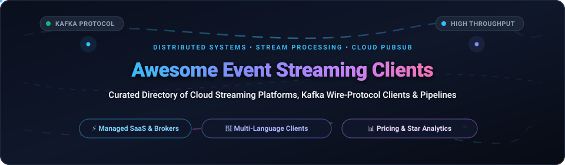

  

# ⚡ Awesome Event Streaming Clients &amp; Platforms

### *A Curated Directory of Cloud Streaming SaaS, Apache Kafka Protocol Clients, Open-Source Brokers &amp; Real-Time Data Pipelines*

---

## 📖 Introduction &amp; Scope

Modern software engineering relies on **Event-Driven Architectures (EDA)** and **high-throughput real-time streaming pipelines**. Whether syncing microservices, processing financial transactions, aggregating telemetry, or powering Retrieval-Augmented Generation (RAG) and Agentic AI workflows, choosing the right combination of **broker infrastructure** and **language-specific client libraries** dictates latency, operational complexity, and infrastructure spend.

This repository provides an authoritative, benchmark-informed directory covering:
- 🌐 **Managed Cloud SaaS Platforms**: Fully managed Kafka brokers, serverless messaging, and enterprise streaming providers with verified pricing and free-tier boundaries.
- 🔌 **Production-Grade Client Libraries**: Native and pure-language drivers across Python, Go, Node.js, C/C++, Java, Rust, and .NET.
- 🛠️ **Open-Source Brokers &amp; Tooling**: Self-hosted Kafka-compatible brokers, stream engines, and ecosystem observability tools.

---

## 📑 Table of Contents

- [📈 Sector Overview &amp; Market Dynamics](#-sector-overview--market-dynamics)
- [☁️ Managed SaaS &amp; Cloud Streaming Platforms](#️-managed-saas--cloud-streaming-platforms)
  - [SaaS Pricing &amp; Tier Comparison Table](#saas-pricing--tier-comparison-table)
  - [Deep Dives: Cloud Streaming Platforms](#deep-dives-cloud-streaming-platforms)
- [💻 Open-Source GitHub Projects &amp; Clients](#-open-source-github-projects--clients)
  - [Open-Source Repositories Ranked by GitHub_Stars](#open-source-repositories-ranked-by-github-stars)
  - [Open-Source Project Profiles](#open-source-project-profiles)
- [🧩 Architectural Selection Matrix](#-architectural-selection-matrix)
- [🤝 How to Contribute](#-how-to-contribute)
- [⭐ Star History](#-star-history)
- [💖 Support &amp; Community](#-support--community)
- [⚖️ Disclaimer &amp; License](#️-disclaimer--license)

---

## 📈 Sector Overview &amp; Market Dynamics

- **Estimated Market Size**: The global Event Streaming and Real-Time Stream Processing market was valued at **$3.8 Billion in 2024** and is projected to expand to **$12.5+ Billion by 2030**, advancing at a compound annual growth rate (**CAGR of ~24.5%**).
- **Market Structure &amp; Fragmentation**: The sector exhibits a **concentrated, protocol-standardized structure ("winner-take-most" around the Apache Kafka wire protocol)**. The core enterprise market is anchored by hyperscalers (AWS MSK, Microsoft Azure Event Hubs, Google Cloud Pub/Sub) and pure-play category pioneer Confluent, which collectively capture over 70% of enterprise streaming workloads. Concurrently, specialized high-efficiency challengers (such as Redpanda with its C++ zero-JVM engine) and serverless scale-to-zero providers (such as Upstash) capture strategic market niches prioritizing ultra-low latency, edge footprints, or bursty workloads.

---

## ☁️ Managed SaaS &amp; Cloud Streaming Platforms

The table below outlines the primary hosted event streaming platforms, sorted in descending order by **Company Size (Revenue / Market Valuation)** to help platform architects weigh institutional scale against specialized vendor performance.

### SaaS Pricing &amp; Tier Comparison Table

| 🏢 Product &amp; Provider | 🌐 Company Size (Valuation / Revenue) | 🏷️ Specific Starting Tier Pricing | 🎁 Free Tier &amp; Trial Limits | ⚡ Key Streaming Protocols &amp; Target Use Case |
| :--- | :--- | :--- | :--- | :--- |
| **[Azure Event Hubs](https://azure.microsoft.com/en-us/products/event-hubs/)**  *(Microsoft)* | **~$3.1 Trillion** Market Cap  *(~$245B+ Annual Rev)* | **$0.015/hr per Throughput Unit (TU)** (~$11/mo base) + $0.028/M ingress events (Basic). **$0.03/hr per TU** (~$22/mo base) for Standard (Kafka protocol enabled). | **12-Month Free Tier**: 1,000,000 ingress events/month on Standard tier (1 TU) during first 12 months, plus **$200 credit** for the first 30 days. No perpetual free tier after month 12. | Native Kafka 1.0+ wire protocol, AMQP 1.0, HTTPS. Seamless integration with Azure Stream Analytics, Fabric, and Functions. |
| **[Google Cloud Pub/Sub](https://cloud.google.com/pubsub)**  *(Google / Alphabet)* | **~$2.2 Trillion** Market Cap  *(~$350B+ Annual Rev)* | **$40.00 per TiB** ($0.04/GiB) for message volume above free tier. Pub/Sub Lite starts at **$0.045/day per MiB/s** throughput (~$1.35/mo) + $0.04/GiB-mo storage. | **Perpetual Free Forever Plan**: **10 GiB** message ingestion and delivery per month free across all regions. New accounts receive **$300 credits** valid for 90 days. | Proprietary Google Cloud REST/gRPC API (Kafka adapter proxy available). Auto-scaling global pub/sub messaging with regional replication. |
| **[Amazon MSK](https://aws.amazon.com/msk/)**  *(Amazon Web Services)* | **~$2.0 Trillion** Market Cap  *(~$600B+ Annual Rev, AWS $105B+)* | **$0.0416/broker-hr** for `kafka.t3.small` (~$30.37/broker-mo, minimum 2 brokers = ~$60.74/mo) + $0.10/GB-mo EBS. Serverless starts at **$0.75/cluster-hr** (~$547.50/mo base) + $0.10/GB in. | **30-Day Free Trial**: Up to **750 broker-hours/month** of `kafka.t3.small` broker usage for single-broker testing for 30 days. AWS Activate startups eligible for $300-$100k promotional credits. | 100% native Apache Kafka protocol. Deep integration with AWS IAM Auth, AWS Glue Schema Registry, CloudWatch, and MSK Connect. |
| **[Confluent Cloud](https://www.confluent.io/confluent-cloud/)**  *(Confluent - NASDAQ: CFLT)* | **~$7.8 Billion** Market Cap  *(~$960M+ Annual Rev / ARR)* | **$0.00/hr cluster base fee** on Basic tier; pay-as-you-go at **$0.11/GB written**, **$0.11/GB read**, **$0.10/GB-mo storage** (first 500 partitions free, then $0.01/partition-hr). Standard starts at $1.50/hr base. | **30-Day Free Trial**: **$400 free credits** valid for 30 days across clusters, managed source/sink connectors, and Schema Registry. No permanent free tier. | De facto standard managed Apache Kafka. Built-in Confluent Schema Registry, fully managed ksqlDB, Apache Flink serverless engine, and 120+ pre-built connectors. |
| **[Aiven for Apache Kafka](https://aiven.io/kafka)**  *(Aiven)* | **~$3.0 Billion** Valuation  *(~$100M+ ARR, Series D)* | **$35.00/month** for Developer Startup plan (2 nodes, 1 MB/s ingress, 2 MB/s egress, 20 topics). Dedicated enterprise multi-node clusters start from **$235.00/month** ($0.32/hr) + $0.10/GB storage. | **30-Day Free Trial**: **$300 promotional credit** across AWS, GCP, or Azure deployment targets. No ongoing perpetual free plan. | Native Apache Kafka with choice of cloud provider (AWS, Azure, GCP, DigitalOcean) and unified billing with OpenSearch/PostgreSQL. |
| **[Redpanda Cloud](https://redpanda.com/cloud)**  *(Redpanda Data)* | **~$450 Million** Valuation  *(~$35M+ ARR, Series C)* | **$0.00/hr cluster base fee** on Serverless; billed at **$0.10/GB ingress**, **$0.10/GB egress**, **$0.10/GB-mo storage**, and **$0.002/partition-hr**. Dedicated tier starts at **$0.48/hr** (~$350.40/mo). | **14-Day Free Trial**: **$100 free usage credits** with instant provisioning, no credit card required upfront. Supports Serverless and BYOC testing. | 100% Kafka wire API compatible written in C++. Up to 10x lower tail latencies, no JVM garbage collection pauses, integrated HTTP proxy and Schema Registry. |
| **[Upstash Kafka](https://upstash.com/kafka)**  *(Upstash)* | **~$50 Million** Valuation  *(~$5M+ ARR, Series A)* | **$0.60 per 100,000 commands/messages** ($0.000006/msg), capped at **$360.00/month max** per cluster. Pro tier starts at **$280.00/month** for dedicated throughput and 99.99% SLA. | **Perpetual Free Forever Plan**: **10,000 commands/day**, 100 MB max data retention, 1 cluster, up to 10 topics. Never expires. | Serverless Kafka with HTTP REST API and standard TCP Kafka wire protocol. Ideal for serverless runtimes (AWS Lambda, Vercel, Cloudflare Workers). |
| **[CloudKarafka](https://www.cloudkarafka.com/)**  *(84codes AB)* | **~$20 Million** Valuation  *(~$12M+ ARR, Private SME)* | **$49.00/month** for "Developer Duck" shared multi-tenant cluster (5 topics, 5 partitions, 10 GB storage, 20 MB/s bandwidth). Dedicated clusters start at **$199.00/month** ("Team Tiger"). | **14-Day Free Trial**: Full access to the Developer Duck tier upon registration. Legacy Developer Pizza tier provided 5 topics and 10 MB storage. | Standard Apache Kafka hosted across AWS and Azure regions, accompanied by managed ZooKeeper/KRaft instances and simple monitoring dashboards. |

---

### Deep Dives: Cloud Streaming Platforms

- **Azure Event Hubs**: Azure's native multi-protocol ingestion service. Supports Kafka 1.0+ clients with zero broker management overhead. Offers capture to Azure Data Lake Storage / Azure Blob Storage and native partition-level scaling.
- **Google Cloud Pub/Sub**: Globally resilient pub/sub architecture built on Google's global fiber backbone. Lacks fixed partition topology, using auto-scaling message subscriptions instead. Best for Google BigQuery streaming ingestion and Google Cloud Dataflow streaming jobs.
- **Amazon MSK**: The standard for AWS environments requiring strict Kafka compatibility, private VPC peering, AWS IAM SASL/SCRAM authentication, and integration with AWS Managed Service for Apache Flink.
- **Confluent Cloud**: The market-leading enterprise Kafka distribution. Provides end-to-end governance with Stream Governance, automated schema validation via Schema Registry, and seamless real-time stream transformation via serverless Apache Flink.
- **Aiven for Apache Kafka**: Multi-cloud streaming with vendor independence. Allows deploying clusters across multiple cloud regions and hyper-scalers while keeping centralized governance and observability in a single pane of glass.
- **Redpanda Cloud**: Built from the ground up in C++ with thread-per-core architecture. Delivers deterministic single-digit millisecond tail latencies while maintaining drop-in compatibility with all Apache Kafka clients and drivers.
- **Upstash Kafka**: Pioneer in scale-to-zero serverless streaming. Supports publishing and consuming directly over standard HTTP/REST or native Kafka protocol, eliminating long-lived TCP connection pool overhead in serverless edge functions.
- **CloudKarafka**: Simple, fixed-price managed Apache Kafka ideal for small projects, staging environments, and engineering teams seeking transparent pricing without complex hyperscaler network ingress/egress formulas.

---

## 💻 Open-Source GitHub Projects &amp; Clients

Below is the ranked inventory of open-source streaming engines, client drivers, and pipeline utilities, **sorted strictly in descending order by GitHub_Stars**.

Beside each project name is a social-style badge displaying current GitHub_Stars that links directly to the project's stargazers page.

### Open-Source Repositories Ranked by GitHub_Stars

| # | 📦 Repository &amp; Stargazers Link | ⭐ Stars_Badge (Click to View Stargazers) | 💻 Language &amp; Role | 🔍 Description &amp; Primary Use Case |
| :-: | :--- | :---: | :--- | :--- |
| **1** | **[Apache Kafka](https://github.com/apache/kafka)** |  | Java / Scala  *(Engine &amp; Core Clients)* | The industry standard distributed event store and stream processing platform. Features native KRaft consensus, Kafka Streams library, and Kafka Connect framework. |
| **2** | **[Apache Pulsar](https://github.com/apache/pulsar)** |  | Java / C++  *(Messaging &amp; Streaming)* | Multi-tenant, distributed pub-sub messaging and streaming platform with tiered storage (BookKeeper) and native multi-datacenter geo-replication. |
| **3** | **[Redpanda](https://github.com/redpanda-data/redpanda)** |  | C++  *(Broker Platform)* | High-performance, Kafka-compatible streaming engine. Zero JVM, zero ZooKeeper, built with thread-per-core hardware utilization for mission-critical tail latencies. |
| **4** | **[Sarama](https://github.com/IBM/sarama)** |  | Go  *(Client Driver)* | Pure Go library for Apache Kafka. The most historically widely adopted Go client supporting transactional producers, balanced consumer groups, and SASL/TLS. |
| **5** | **[Kafka UI](https://github.com/provectus/kafka-ui)** |  | TypeScript / Java  *(Observability)* | Open-source web UI for Apache Kafka management. Inspect brokers, topics, consumer groups, Schema Registry schemas, and track message latency in real time. |
| **6** | **[segmentio/kafka-go](https://github.com/segmentio/kafka-go)** |  | Go  *(Client Driver)* | Pure Go library providing both low-level protocol access and high-level Reader/Writer abstractions. Designed specifically for clean Go idiomatic context cancellation. |
| **7** | **[kafka-python](https://github.com/dpkp/kafka-python)** |  | Python  *(Client Driver)* | Pure-Python client for Kafka. Zero native C dependencies makes it universally installable anywhere Python or PyPy runs, suitable for constrained environments. |
| **8** | **[kcat (kafkacat)](https://github.com/edenhill/kcat)** |  | C  *(CLI Utility)* | Generic non-JVM command-line producer and consumer for Apache Kafka. The Swiss Army knife for debugging topics, dumping JSON payloads, and measuring lag. |
| **9** | **[FastStream](https://github.com/airtai/faststream)** |  | Python  *(Framework)* | Powerful FastAPI-like framework for building asynchronous event-driven microservices across Kafka, RabbitMQ, and NATS with built-in schema serialization. |
| **10** | **[confluent-kafka-go](https://github.com/confluentinc/confluent-kafka-go)** |  | Go / C (cgo)  *(Client Driver)* | Confluent's official Go client wrapping `librdkafka`. Offers battle-tested production throughput, Schema Registry, and enterprise serialization features. |
| **11** | **[KafkaJS](https://github.com/tulios/kafkajs)** |  | TypeScript / JS  *(Client Driver)* | Modern, pure-JavaScript Kafka client for Node.js. Fully asynchronous promise-based API with zero compilation dependencies and comprehensive consumer rebalancing. |
| **12** | **[franz-go](https://github.com/twmb/franz-go)** |  | Go  *(Client Driver)* | Ultra-fast, zero-dependency, pure Go client for Kafka 0.8 through 4.x. Renowned for low memory allocations, complete protocol fidelity, and high performance. |
| **13** | **[Karafka](https://github.com/karafka/karafka)** |  | Ruby  *(Framework)* | Multi-threaded event-driven framework for Ruby and Ruby on Rails. Simplifies consuming, routing, and processing streaming messages in Rails services. |
| **14** | **[rust-rdkafka](https://github.com/fede1024/rust-rdkafka)** |  | Rust / C  *(Client Driver)* | Safe, idiomatic Rust wrapper around `librdkafka`. Offers asynchronous Futures-based APIs and synchronous consumers with zero-cost memory safety. |
| **15** | **[aiokafka](https://github.com/aio-libs/aiokafka)** |  | Python  *(Client Driver)* | Asynchronous I/O client for Kafka utilizing Python's `asyncio`. Built for FastAPI, Sanic, and Tornado services where thread blocking must be avoided. |
| **16** | **[librdkafka](https://github.com/confluentinc/librdkafka)** |  | C / C++  *(Core Engine Driver)* | High-performance C/C++ library implementing the Apache Kafka protocol. Serves as the high-throughput engine underneath Python, Go, Node, and C# wrappers. |
| **17** | **[confluent-kafka-python](https://github.com/confluentinc/confluent-kafka-python)** |  | Python / C  *(Client Driver)* | Confluent's official Python client based on `librdkafka`. Provides built-in Schema Registry client (Avro, Protobuf, JSON Schema) and high-throughput polling. |
| **18** | **[confluent-kafka-dotnet](https://github.com/confluentinc/confluent-kafka-dotnet)** |  | C# / .NET  *(Client Driver)* | Confluent's official .NET client for Apache Kafka. Wraps `librdkafka` with strongly typed C# serializers, async producers, and reactive consumer pipelines. |

---

### Open-Source Project Profiles

#### 1. ☕ [Apache Kafka](https://github.com/apache/kafka)
- **Role**: Distributed streaming platform &amp; protocol origin.
- **Highlights**: The standard event broker worldwide. Features the KRaft consensus mechanism (eliminating ZooKeeper dependency), exactly-once semantics (EOS), and built-in Kafka Streams.
- **When to Use**: Enterprise workloads requiring standard protocol compliance, long-term ecosystem maturity, and complete control over storage topologies.

#### 2. 🌌 [Apache Pulsar](https://github.com/apache/pulsar)
- **Role**: Multi-tenant distributed messaging and streaming.
- **Highlights**: Architecture segregating compute (brokers) from persistent storage (Apache BookKeeper). Supports native tiered storage to S3/GCS and multi-tenant namespaces.
- **When to Use**: Multi-region deployments with complex tenancy needs or multi-datacenter active-active geo-replication.

#### 3. 🐼 [Redpanda](https://github.com/redpanda-data/redpanda)
- **Role**: High-performance, Kafka API compatible streaming platform.
- **Highlights**: C++ thread-per-core engine with zero JVM heap management. Runs as a single self-contained binary with built-in Schema Registry, WASM data transforms, and Raft consensus.
- **When to Use**: Teams wanting Kafka client compatibility with significantly lower cloud hardware footprints and microsecond p99 tail latency.

#### 4. 🦫 [IBM/sarama](https://github.com/IBM/sarama)
- **Role**: Pure Go client driver for Kafka.
- **Highlights**: Pure Go implementation requiring no cgo or external C libraries. Supports balanced consumer groups, transactional guarantees, and SASL authentication.
- **When to Use**: Standard Go services that need uncomplicated cross-compilation across diverse architectures without native cgo toolchains.

#### 5. 🖥️ [Provectus Kafka UI](https://github.com/provectus/kafka-ui)
- **Role**: Free open-source management and monitoring dashboard.
- **Highlights**: Lightweight web interface supporting multi-cluster management, dynamic topic creation, consumer offset auditing, and integrated Schema Registry viewing.
- **When to Use**: Development and DevOps teams needing immediate visual inspection into message payloads and cluster health.

#### 6. 🏎️ [franz-go](https://github.com/twmb/franz-go)
- **Role**: Modern, high-performance pure Go Kafka client.
- **Highlights**: Zero dependencies, fully supports Kafka protocol features up through Kafka 4.x, and aggressively minimizes allocations and memory copying.
- **When to Use**: High-throughput Go microservices where garbage collection overhead and cgo cross-compiling friction are bottlenecks.

#### 7. 🐍 [FastStream](https://github.com/airtai/faststream)
- **Role**: Asynchronous event-driven microservice framework for Python.
- **Highlights**: Offers declarative, FastAPI-style route decorators (`@broker.subscriber("topic")`), automatic Pydantic schema validation, and interactive AsyncAPI documentation generation.
- **When to Use**: Modern Python backends adopting event-driven microservices with structured typing.

#### 8. 🛠️ [kcat (formerly kafkacat)](https://github.com/edenhill/kcat)
- **Role**: Command-line producer, consumer, and metadata inspector.
- **Highlights**: Built on `librdkafka`, allows piping data from stdin to Kafka topics, querying partition offsets, and decoding schema-encoded messages from the terminal.
- **When to Use**: Indispensable utility for platform debugging, incident triage, and CI/CD smoke testing.

---

## 🧩 Architectural Selection Matrix

| Language / Stack | Recommended Client Library | Key Strengths | Considerations |
| :--- | :--- | :--- | :--- |
| **Python (AsyncIO / FastAPI)** | **`aiokafka`** or **`FastStream`** | Native non-blocking event loop integration, async iterators. | No native Schema Registry; pair with FastStream or external deserializers. |
| **Python (Schema Registry / ETL)** | **`confluent-kafka-python`** | Native Avro, Protobuf, and JSON schema deserialization; C engine performance. | Requires platform wheels or cgo build tools. |
| **Python (Constrained / PyPy)** | **`kafka-python`** | Pure Python with zero compilation; universal install. | Slower parsing throughput; lack of modern protocol updates. |
| **Go (High Performance)** | **`franz-go`** | Zero dependencies, lowest allocations, modern Kafka 4.x support. | Pure Go; requires learning franz-go's distinct client idioms. |
| **Go (Legacy / Broad Support)** | **`sarama`** or **`kafka-go`** | Massive community adoption, straightforward API. | Higher memory allocation profile compared to `franz-go`. |
| **Node.js / TypeScript** | **`kafkajs`** | Pure JS/TS, promise-based API, zero native build tooling. | Moderate throughput compared to native C wrappers. |
| **Rust** | **`rust-rdkafka`** | Memory safety, zero-copy async stream processing with Tokio. | Depends on underlying `librdkafka` C libraries. |
| **C# / .NET** | **`confluent-kafka-dotnet`** | Official Confluent support, strongly typed serialization. | Backed by `librdkafka` native runtime binaries. |
| **Ruby / Rails** | **`karafka`** | Idiomatic multi-threaded Rails integration, background processing. | Built on `librdkafka` under the hood. |

---

## 🤝 How to Contribute

We welcome additions, client benchmarks, and ecosystem updates from data engineers and developers worldwide!

1. 🍴 **Fork this repository** to your GitHub account.
2. 🌿 **Create a new branch** (`git checkout -b feature/add-client`).
3. 📝 **Add or update an entry** in `README.md`:
   - For SaaS products: Include specific tier pricing, verified free tier limits, company valuation/revenue, and supported wire protocols.
   - For Open-Source repositories: Add the social Stars_Badge linking to the repo's stargazers page and ensure the star-sorted sequence is preserved.
4. ✅ **Ensure formatting passes** clean markdown guidelines and links are valid.
5. 🚀 **Submit a Pull Request** with a descriptive summary of your additions.

---

## ⭐ Star History

---

## 💖 Support &amp; Community

If you find this curated event streaming ecosystem list helpful for your architecture decisions and engineering pipelines, please consider supporting the project:

- ⭐ **Star this repository** on GitHub to help other engineers and teams discover it!
- 🍴 **Fork and contribute** new clients, benchmarks, and architectural patterns.
- 📢 **Share** with your network, platform team, and data engineering channels.
- ☕ **Sponsor / Buy a coffee**: Support ongoing research, maintenance, and tooling updates via the [GitHub Sponsors Dashboard](https://github.com/sponsors/ishandutta2007).

---

## ⚖️ Disclaimer &amp; License

- This repository is a community-curated directory intended for research, architectural planning, and educational purposes. Product trademarks and service logos belong to their respective corporate entities.
- "Kafka-compatible" platforms do not necessarily guarantee 100% parity across all Kafka protocol APIs (e.g., compaction semantics, transaction coordinators, or Schema Registry protocols). Always benchmark target workloads before production migration.
- Distributed streaming architectures require proper partition sizing, broker quorum configuration, and monitoring to avoid data loss.

Distributed under the [MIT License](LICENSE). Built with ❤️ for the global data engineering and distributed systems community.
